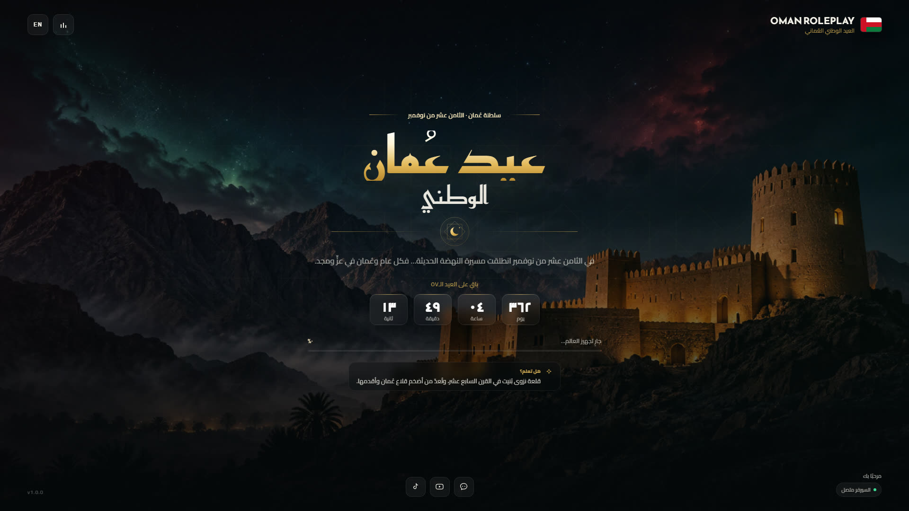

# qb-loading-oman

**شاشة تحميل اليوم الوطني العُماني** — QBCore · FiveM · بدون أي مكتبات خارجية
**Omani National Day loading screen** — QBCore · FiveM · zero external libraries



---

## العربية

### المميزات

- هوية اليوم الوطني العُماني (18 نوفمبر) بألوان العلم والذهبي.
- واجهة **عربية RTL افتراضيًا** مع زر تبديل فوري للإنجليزية.
- عدّاد تنازلي تلقائي لليوم، ويتحوّل إلى **وضع احتفال** يومي 18 و19 نوفمبر.
- 4 خلفيات سينمائية تتبدّل بانتقال ناعم مع حركة Ken Burns.
- ألعاب نارية وجزيئات ذهبية مرسومة على Canvas (بدون صور متحركة ثقيلة).
- شريط تقدّم + رسائل حالة متغيّرة + نصائح تُبدَّل تلقائيًا.
- ترحيب باسم اللاعب وعدد المتصلين (من السيرفر).
- روابط تواصل قابلة للتعديل: Discord / YouTube / TikTok / Instagram / X / موقع.
- مشغّل موسيقى اختياري يظهر فقط إذا كان ملف الصوت موجودًا.
- خطوط عربية مضمّنة محليًا (Cairo + Reem Kufi) — تعمل بدون إنترنت.
- خفيفة: ≈ 1.6MB كل الأصول، ولا يوجد أي CDN أو مكتبة JS.

### التثبيت

1. انسخ مجلد `qb-loading-oman` إلى مجلد `resources/` في سيرفرك.
2. أضف في `server.cfg`:
   ```cfg
   ensure qb-loading-oman
   ```
3. أعد تشغيل السيرفر.

السكربت لا يعتمد على أي إطار عمل، ويعمل مع QBCore و ESX وستاندالون.

### الإعدادات

كل شيء من ملف `config.lua`:

| المفتاح | الوصف |
| --- | --- |
| `ServerName` | اسم السيرفر أعلى الشاشة |
| `Version` | رقم الإصدار في الزاوية |
| `DefaultLanguage` | `'ar'` عربي أو `'en'` إنجليزي |
| `Theme` | ألوان `red` / `green` / `gold` / `bg` بصيغة HEX |
| `Countdown.enabled` | تشغيل أو إخفاء العدّاد |
| `Countdown.month` / `day` | تاريخ اليوم (11 / 18) |
| `Countdown.celebrationDays` | عدد أيام وضع الاحتفال بعد التاريخ |
| `Countdown.startYear` | يُستخدم لحساب رقم اليوم (مثال: اليوم الـ57) |
| `Backgrounds.interval` | مدة ظهور كل خلفية بالمللي ثانية |
| `Backgrounds.images` | مسارات الخلفيات (حتى 4 صور) |
| `Socials` | `{ icon, label, url }` — اترك `url` فارغًا لإخفاء الزر |
| `Tips` | نصائح بلغتين: `{ ar = '...', en = '...' }` |
| `StatusMessages` | رسائل حالة التحميل بلغتين |
| `ReadyMessage` | رسالة نهاية التحميل |
| `Music` | `enabled` / `file` / `volume` / `autoplay` |
| `UI` | إظهار أو إخفاء اسم اللاعب، عدد اللاعبين، الحالة، اللغة، الموسيقى، الألعاب النارية |

### الموسيقى

المقطعان مرفقان في `html/audio/`:

| الملف | المقطع | الحالة |
|---|---|---|
| `m1.mp3` | «يا عمان حن لك فداء» — أسعد البطحري | **النشِط** |
| `m2.mp3` | «احكم سلاطين الأرض» — محمد بن غرمان | احتياطي |

- لتشغيل المقطع الثاني: عدّل `Config.Music.file = 'audio/m2.mp3'` في `config.lua`.
- زر الموسيقى يظهر تلقائيًا عند تحميل الملف، ويختفي إذا لم يوجد، والصوت يبدأ بتلاشٍ ناعم.
- **تنبيه حقوق:** المقطعان محميّان بحقوق ولا يشملهما ترخيص MIT. استبدلهما قبل النشر العام أو تأكد من امتلاكك حقوق الاستخدام.

### الخلفيات والخطوط

- استبدل الصور في `html/img/` بنفس الأسماء (`bg-fort.jpg` …) أو أضف مساراتك في `config.lua`.
- الخطوط محليّة في `html/fonts/`. لتغيير الخط عدّل `@font-face` في `html/css/style.css`.

### ملاحظات مهمة

- **الإغلاق:** الشاشة تُغلق تلقائيًا عند اكتمال التحميل، وهذا ضروري في QBCore كي تظهر شاشة اختيار الشخصية. لو تبي التحكم اليدوي بالإغلاق فعّل `loadscreen_manual_shutdown` في `fxmanifest.lua` (موجود كتعليق) واستدعِ `ShutdownLoadingScreenNui()` في `client.lua`.
- **العلم:** مرسوم بـ CSS بألوانه وترتيبه الصحيح، بدون شعار الخنجر لتفادي رسم غير دقيق. تقدر تضيف صورة العلم الرسمي إذا رغبت.
- **المعاينة السريعة:** افتح `html/index.html` مباشرة، أو أضف `?lang=en` لعرض النسخة الإنجليزية.

### الاعتمادات

- خطوط **Cairo** و **Reem Kufi** — بترخيص SIL Open Font License 1.1.
- الخلفيات مولّدة بالذكاء الاصطناعي خصيصًا لهذا المشروع.
- لا توجد أي مكتبات JavaScript خارجية.

### الترخيص

MIT — راجع ملف `LICENSE`.

---

## English

### Features

- Omani National Day theme (18 November) using the flag palette and gold accents.
- **Arabic RTL by default** with an instant English toggle.
- Automatic countdown that switches to a **celebration state** on 18–19 November.
- 4 cinematic backgrounds with soft crossfades and Ken Burns motion.
- Canvas fireworks and gold dust — no heavy animated assets.
- Progress bar, rotating status messages and tips.
- Player name and online player count from the server.
- Editable social links: Discord / YouTube / TikTok / Instagram / X / website.
- Optional music player that only appears when the audio file exists.
- Arabic fonts bundled locally (Cairo + Reem Kufi) — no internet required.
- Lightweight: ~1.6MB of assets, no CDN and no JS libraries.

### Installation

1. Copy the `qb-loading-oman` folder into your `resources/` directory.
2. Add to `server.cfg`:
   ```cfg
   ensure qb-loading-oman
   ```
3. Restart the server.

Framework-agnostic: works with QBCore, ESX and standalone servers.

### Configuration

Everything lives in `config.lua` — see the table above. Highlights:

```lua
Config.ServerName = 'عُمان رول بلاي'
Config.DefaultLanguage = 'ar'            -- 'ar' or 'en'
Config.Countdown = { month = 11, day = 18, celebrationDays = 2, startYear = 1970 }
Config.Socials = {
    { icon = 'discord', label = 'Discord', url = 'https://discord.gg/your-invite' },
}
Config.Music = { enabled = true, file = 'audio/m1.mp3', volume = 0.30, autoplay = true }
```

### Music

Two tracks ship in `html/audio/`:

| File | Track | Status |
|---|---|---|
| `m1.mp3` | “Ya Oman Han Lak Fida” — As'ad Al-Bat-hari | **Active** |
| `m2.mp3` | “Ahkam Salateen Al-Ard” — Mohammed Bin Grman | Alternate |

- To play the second track: set `Config.Music.file = 'audio/m2.mp3'` in `config.lua`.
- The button appears once the file loads, hides when missing, and the audio fades in gently.
- **Licensing:** both tracks are copyrighted and are NOT covered by the MIT license. Replace them before public release or make sure you hold the rights.

### Notes

- **Shutdown:** the screen closes automatically when loading completes, which is required for QBCore's character selection. For manual control, enable `loadscreen_manual_shutdown` in `fxmanifest.lua` (left as a comment) and call `ShutdownLoadingScreenNui()` in `client.lua`.
- **Flag:** drawn in CSS with correct colors and geometry, without the khanjar emblem to avoid an inaccurate rendering. You may replace it with an official flag image.
- **Quick preview:** open `html/index.html` directly, or add `?lang=en` for English.

### Credits & License

- **Cairo** and **Reem Kufi** fonts — SIL Open Font License 1.1.
- Backgrounds AI-generated for this project.
- MIT License — see `LICENSE`.

---

**Version:** 1.0.0 · **Tested at:** 1920×1080 and 1366×768
